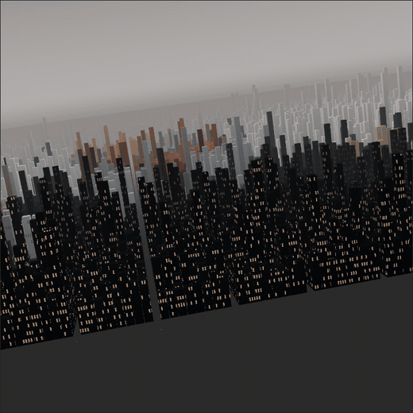

# You Are A City

**Type an X handle. Fly over a city of 20,000 towers. Then the camera lifts, and the city turns out to be you.**

Live: **[youareacity.xyz](https://youareacity.xyz)**



A small WebGL toy that rebuilds any profile picture as a 3D city, or as a cloud of particles, and lets you record the result as a clip to post. No build step, no backend, no tracking. Two HTML files.

## What it does

### City mode

- Every pixel of the profile picture becomes one tower: 144 × 144 = **20,736 towers**, laid out in blocks with streets and traffic between them.
- The clip opens low over the skyline. Towers are in the picture's colours, with lit windows on dark walls and dark glass on light ones, so it reads as a city, not a photo.
- The camera climbs and tilts straight down while a colour wave crosses the city, the streets close up, and the towers settle into a relief of the picture.
- The sky, haze, ground and page accent colour are all taken from the picture, so every profile gets its own look.
- Each city gets its own stats (population and skyscraper count), computed from the tower heights.
- After the reveal the city behaves like a rubber sheet: grab it anywhere, pull, and let go to watch it spring back.

### Particles mode

- A spiral galaxy of ~75,000 particles collapses into the profile picture, with a ring of dust orbiting it.
- The portrait then breaks apart and rewrites itself as an X badge and the `@handle`, and returns.
- Three shapes (Relief, Ripple, Layers), click to send a shockwave, drag to spin.

### Sharing

- **Share on X** copies the current frame to the clipboard and opens a pre-filled post (native share sheet on phones).
- **Record 10s clip** captures the canvas with `MediaRecorder`: MP4 where the browser supports it, WebM otherwise.
- The handle and site address are drawn into the canvas, so they appear in every image and clip.

## Run it locally

There is nothing to install. Clone the repo, then serve the folder with any static server:

```bash
python3 -m http.server 5240
```

Open <http://localhost:5240>. Particles mode is at `/particles.html`.

A server is needed (opening the file directly will not work) because the pages load three.js as an ES module.

## URL parameters

| Parameter | Page | Effect |
|---|---|---|
| `?u=handle` | both | Opens straight into that X profile. Useful for sharing a direct link. |
| `?at=seconds` | city | Freezes the flight at one moment. Used for checking individual frames. |
| `?pull=1` | city | Holds a corner of the city pulled, for checking the grab effect. Combine with `?at=9`. |

## How it works

Everything runs in the browser, in one `<script type="module">` per page.

1. **Get the picture.** A typed handle is fetched from [unavatar.io](https://unavatar.io) (`/x/<handle>`), which serves avatars with CORS headers. An uploaded photo is read locally. Either way it is centre-cropped and drawn to a small canvas.
2. **Read the pixels.** `getImageData` gives one colour per grid cell. Brightness is blurred slightly to get a smooth height map.
3. **Build the geometry once.**
   - *City:* a single `InstancedBufferGeometry` box, with per-instance attributes for position, colour, skyline height and relief height. One draw call for all 20,736 towers.
   - *Particles:* a single `Points` object with per-particle attributes for the portrait position, galaxy position and text position.
4. **Animate in the shader.** The JavaScript only updates a handful of uniforms per frame (time, progress, camera). Growth, the colour wave, the street-closing, the rubber-sheet pull, window lights and the galaxy-to-portrait morph are all computed in the vertex and fragment shaders.
5. **Theme from the picture.** The average colour drives the sky, haze and ground; the most saturated hue becomes the accent colour.
6. **Overlay.** Captions are drawn to a 2D canvas, uploaded as a texture and rendered as a full-screen quad on top, so they are part of the WebGL canvas and end up in recordings.

The rubber-sheet effect is a damped spring on a single pull vector: the grabbed point moves fully, and every other tower moves by `exp(-distance² × k)` of that.

## Project structure

```
index.html       City mode (markup, styles, shaders and logic)
particles.html   Particles mode
vercel.json      Clean URLs (/particles instead of /particles.html)
docs/demo.gif    The preview at the top of this README
```

## Tech

- [three.js](https://threejs.org) r160, loaded from jsDelivr through an import map
- Custom GLSL shaders (`ShaderMaterial`), no post-processing
- `MediaRecorder` + `canvas.captureStream` for clips, Clipboard and Web Share APIs for images
- Google Fonts: Instrument Serif and JetBrains Mono
- Hosted as static files on Vercel

## Privacy

- **Uploaded photos never leave the device.** They are read and drawn locally; nothing is uploaded.
- **Typed handles** are requested from unavatar.io by the visitor's browser, so that service sees which handle was asked for. The fetched picture is kept in `sessionStorage` for the tab, so switching modes does not download it again.
- There is no backend, no database, no analytics and no cookies.

## Browser support

Works in current Chrome, Edge, Safari and Firefox with WebGL enabled. Recording produces MP4 in Safari and recent Chrome; other browsers fall back to WebM, which X does not accept without converting.

The city renders 20,736 instanced towers at 1620 × 1620, so older phones and integrated GPUs may drop frames.

## Deploy

Any static host works. With Vercel:

```bash
vercel deploy --prod
```

## Contributing

Issues and pull requests are welcome. The whole project is two self-contained files, so the easiest way in is to open `index.html`, find the shader near the top of the script, and change something.

Ideas that would fit well:

- A lighter quality tier for phones and weaker GPUs
- More reveal styles for the city
- An avatar source that does not depend on a third-party service

## Credits

Made by [@shxwat](https://x.com/shxwat).

Not affiliated with X Corp. Profile pictures belong to their owners; this project only displays them in the visitor's own browser.

## License

[MIT](LICENSE)
